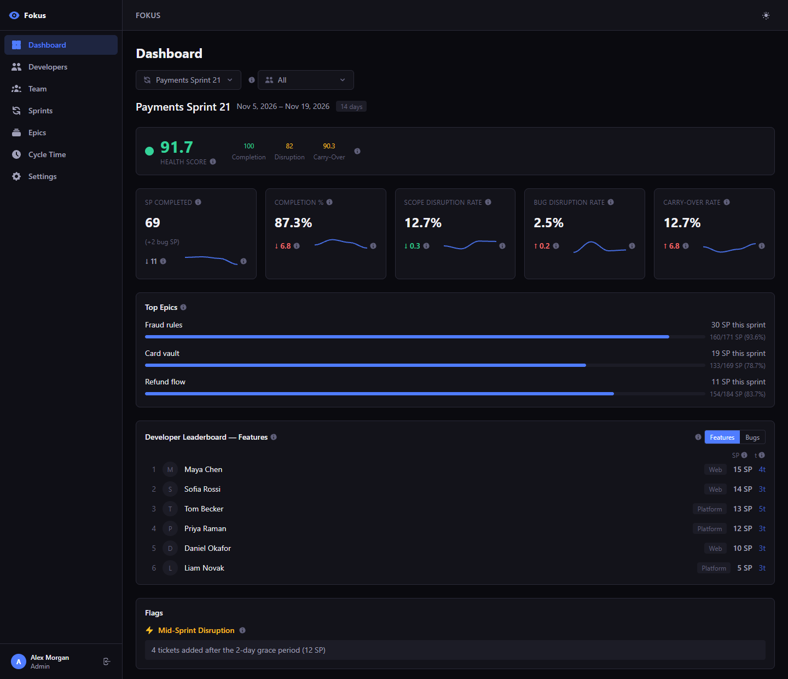
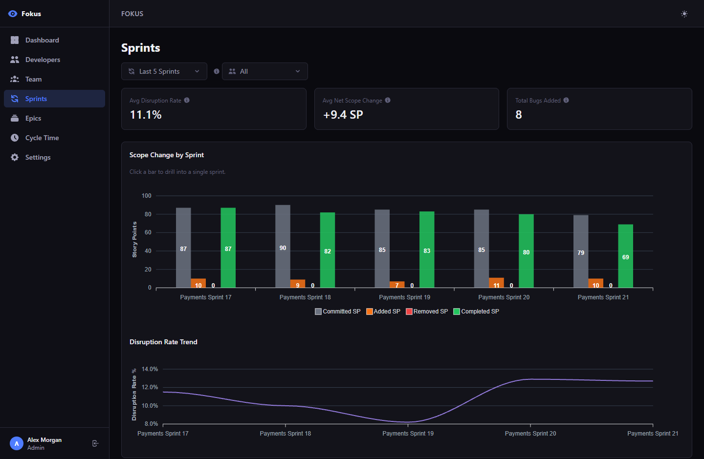
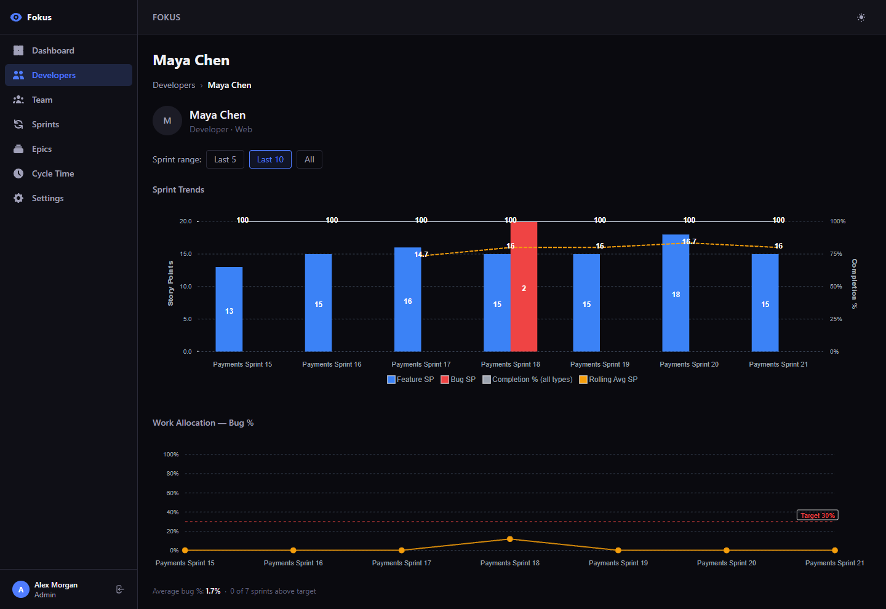
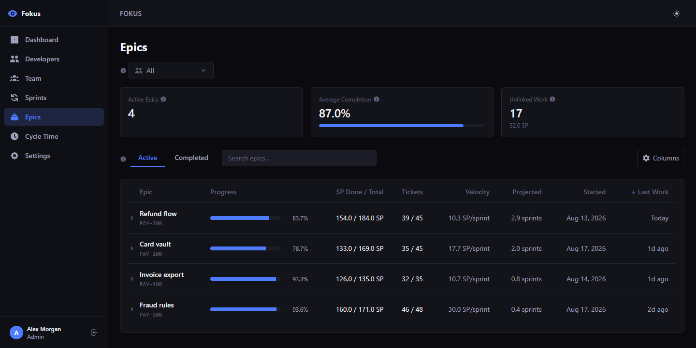
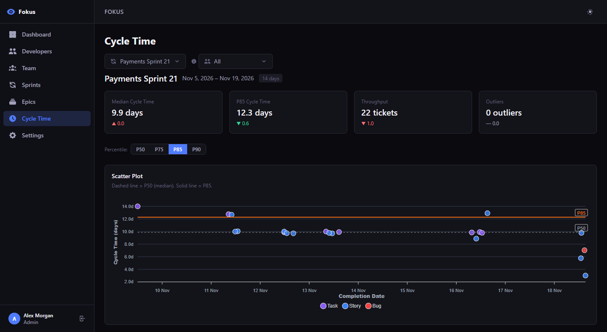

# Fokus

**Sprint analytics for Jira, built entirely by AI agents.**

Fokus syncs your sprints from Jira and answers the questions Jira's own reports leave open: how much of the planned work got done, how much changed mid-sprint, which tickets keep rolling over, who delivered what, and where tickets wait. No Jira plugin is needed, and it works with any Jira plan, including Free. The repo is also a teaching example. Every feature was specified, planned, implemented and reviewed by [Claude Code](https://docs.anthropic.com/en/docs/claude-code) agents, and the records of that work are kept here next to the code.

    



## Why this repo

| If you want... | You get... |
|---|---|
| **Sprint analytics for your team** | A dashboard for Scrum Masters and engineering managers that reads one Jira board, works out every figure locally and keeps the history. Deploys to a single Azure App Service. |
| **To see how agents build software** | A full application, not a demo, with the specs, plans, reviews and lessons behind each feature. Start at [How it was built](#how-it-was-built). |
| **A .NET and Vue reference** | Domain-driven design with vertical slices, pure domain calculators and an application layer, in a codebase small enough to read. Start at the [architecture map](docs/architecture-map/index.md). |

## What it shows

Fokus syncs a board's sprints, tickets and the full status history of every ticket. Each figure comes from that history, not from a ticket's status at the moment of the sync: a ticket counts as started in the sprint where it first moved into your "started" stage, and as completed in the sprint where it reached "done". So work that was planned, added late, carried over or finished in a later sprint is counted where it really happened.

| View | What it answers |
|---|---|
| **Dashboard** | How did this sprint go? A health score from completion, disruption and carry-over, metric cards with trends over the last sprints, top epics, a developer leaderboard and flags for mid-sprint disruption and long-running tickets. |
| **Sprints** | How much did the scope change? Committed, added, removed and completed story points per sprint, the disruption trend, and carry-over by workflow stage. |
| **Developers** | Who delivered what? Throughput, bug ratio, a leaderboard and a daily progress view that refreshes itself as tickets move. Each developer has a page with their trends across sprints. |
| **Epics** | How far along is each epic, and when will it finish at the current pace? |
| **Cycle Time** | How long does a ticket take from start to done, and which stage holds it up? |
| **QA** | With Xray switched on: test coverage, pass rates and test execution trends per sprint. |

<table>
  <tr>
    <td width="50%" valign="top"><a href="docs/images/sprints.png"></a></td>
    <td width="50%" valign="top"><a href="docs/images/developer-detail.png"></a></td>
  </tr>
  <tr>
    <td align="center"><b>Sprints:</b> scope change and disruption, sprint by sprint</td>
    <td align="center"><b>Developer:</b> one person's delivery across sprints</td>
  </tr>
</table>

<details>
<summary><b>See more: epic progress and cycle time</b></summary>
<br>

<br><br>

</details>

The people, team, tickets and figures in these pictures are invented.

## Features

| Feature | What it does |
|---|---|
| **Jira sync** | Pulls sprints, tickets and their status history from one Jira board, on demand: a single sprint or a full backfill. Uses an Atlassian API token, no plugin. |
| **Workflow detection** | Reads the board's statuses and proposes the workflow stages; you choose where cycle time starts and ends. |
| **Sprint health** | A health score with green, amber and red levels. Thresholds and weights are set in Settings. |
| **Scope change** | Disruption rate, work added after the planning window, removed work and a burnup chart with the bug work shown apart. |
| **Carry-over** | Carry-over rate, where carried tickets were stuck, what happened to them in the next sprint, and tickets that have sat in three or more sprints. |
| **Bug ratio** | Bug against feature story points per developer and sprint, with an alert when a team stays over a threshold. Unestimated bugs can count a default size. |
| **Cycle time** | Median and percentiles, outliers, a stage funnel that shows the slowest stage, and a breakdown by issue type and developer. |
| **Epic progress** | Progress, velocity and a projection of the sprints left for each epic. |
| **Daily progress** | Each developer's pace in the running sprint, with stalled tickets flagged; the page updates itself over SignalR after a sync. |
| **Sub-teams and capacity** | Tag developers with a sub-team and filter every view by it; set capacity per sprint so part-time weeks don't skew the figures. |
| **Xray (optional)** | Test executions from Xray: coverage, pass rate, QA workload and an epic's test health. |
| **Users and invitations** | Google sign-in. The first person to sign in becomes the administrator and invites everyone else as an admin or a read-only manager. |

## Architecture at a glance

One ASP.NET Core service serves the API, a SignalR hub and the built Vue app, backed by one SQLite file. Jira and Xray are reached through two small client modules.

```
Browser (Vue 3 + Pinia + ApexCharts)
   │  HTTP (FastEndpoints)                 SignalR (/hubs/sprint)
   ▼                                            ▲
Fokus.API ── one folder per feature slice ──────┘ pushes "sync finished" to the daily progress page
   │   the endpoint loads, calls a calculator, maps the reply
   ▼
Fokus.Application ── loaders that span many repositories, the Jira and Xray sync services
   │
Fokus.Domain ── aggregates and pure analytics calculators (no database, no clock)
   │
Fokus.Persistence ── EF Core + SQLite; migrations apply on start-up
          │ REST                         │ GraphQL
          ▼                              ▼
     Jira (Jira.RestApi)           Xray (Xray.GraphQL)
```

| Layer | Stack |
|---|---|
| **Backend** | .NET 10, ASP.NET Core, [FastEndpoints](https://fast-endpoints.com/), FluentValidation, SignalR |
| **Data** | EF Core 10 with SQLite; every figure is worked out per request, none is stored |
| **Sign-in** | Google OAuth with cookies; admin and manager roles |
| **Frontend** | Vue 3, TypeScript, Pinia, Tailwind CSS 4, ApexCharts, built with Vite into the API's `wwwroot/` |
| **Tests** | xUnit, FluentAssertions, NSubstitute |

The [architecture map](docs/architecture-map/index.md) describes the code project by project; each fact comes with the command that proves it.

## Quick start

You need the [.NET 10 SDK](https://dotnet.microsoft.com/download), [Node.js](https://nodejs.org/) 20.19+ or 22.12+, a Jira account with an [API token](https://id.atlassian.com/manage-profile/security/api-tokens) (the free plan works) and a Google OAuth client. There is no demo mode: the dashboard shows the sprints it syncs from your Jira project.

**1. Clone and install** the frontend packages:

```powershell
git clone https://github.com/DotNetLabX/fokus.git
cd fokus
npm ci --prefix client
```

**2. Create your local settings file** from the committed template. `appsettings.Development.json` is git-ignored, so your secrets stay local:

```powershell
cp src/Services/Fokus/Fokus.API/appsettings.json src/Services/Fokus/Fokus.API/appsettings.Development.json
```

In that file, replace the `<…>` placeholders:

- `Google:ClientId`, `Google:ClientSecret`: your OAuth client (see below)
- `Jira:InstanceUrl` (for example `https://your-org.atlassian.net`), `Jira:Email`, `Jira:ApiToken`, `Jira:ProjectKey`

**3. Start the API.** It creates the database by itself and listens on `http://localhost:5000`.

```powershell
dotnet run --project src/Services/Fokus/Fokus.API
```

**4. Start the frontend** in a second terminal, from the repository root, then open `http://localhost:5173`.

```powershell
npm run dev --prefix client
```

**5. Sync.** Sign in (the first person becomes the administrator), open Settings, choose the board on the Jira tab, check the stages on the Workflow tab, and use **Sync from Jira** on the Sync tab.

<details>
<summary><b>Creating the Google OAuth client</b></summary>
<br>

In the [Google Cloud Console](https://console.cloud.google.com/), under APIs & Services → Credentials, create an OAuth 2.0 Client ID of type Web application and add `http://localhost:5000/auth/callback` as an authorized redirect URI. Use the backend's address even when you open the app on port 5173: the dev server forwards `/auth` to the backend.
</details>

<details>
<summary><b>Xray test data</b></summary>
<br>

To see the QA views, set `Xray:ClientId` and `Xray:ClientSecret` in the same settings file, or enter them on the Xray tab in Settings, then sync.
</details>

### Tests and build

From the repository root:

```powershell
# Backend: the unit tests
dotnet test src/Fokus.slnx

# Frontend: type-check and production build, output goes to the API's wwwroot/
npm ci --prefix client
npm run build --prefix client
```

### Deploy

`deploy.ps1` builds the frontend, publishes the API and deploys it to an Azure App Service (Linux), with the SQLite file on the app's persistent storage. It reads a config file that only deployment needs:

```powershell
mkdir .credentials
cp deploy-config.example.ps1 .credentials/deploy-config.ps1   # fill in your values
.\deploy.ps1
```

Creating the Azure resources, the app settings and the sign-in redirect is covered in [docs/deployment-azure.md](docs/deployment-azure.md).

## How it was built

Fokus was built by AI agents working as a team, with a human owner deciding what to build and approving each step. Separate agents take separate roles and hand work to each other through files:

```
Owner → PO (spec) → Architect (plan) → Developer (implement)
      → Architect (done check) + Reviewer (code review) → Done → Learner (lessons into rules)
```

The agent setup used for most features is in `.claude/` as it was. The later features, from `F37` on, ran on [Nexus](https://github.com/DotNetLabX/claude-nexus), a multi-agent pipeline for Claude Code that grew out of this setup.

| Where | What you find |
|---|---|
| `docs/specs/` | One folder per feature (`F1`–`F40`), bug, gap or ad-hoc change. `definition/` holds the spec; `delivery/` the plan, the implementation record, the reviews, the lessons and the summary. |
| `docs/backlog.md` | The feature sequence and status |
| `docs/product/` | The product docs: the original vision and its second version |
| `docs/kb/` | The knowledge base: business rules, formulas and edge cases behind every figure |
| `docs/conventions/` | The coding conventions and project rules the agents follow |
| `docs/proposals/`, `docs/research/` | Design proposals and research written before larger changes |
| `docs/plugin-feedback/` | Problems found in the agent tooling while building, written up for the plugin |

### Finding your way around

| Path | What's there |
|---|---|
| `src/Services/Fokus/` | The service: `Fokus.API` (one folder per feature slice), `Fokus.Application`, `Fokus.Domain`, `Fokus.Persistence`, `Fokus.Tests` |
| `src/Modules/` | The Jira and Xray clients, each a contracts project and an implementation |
| `src/BuildingBlocks/` | Shared libraries with no Fokus knowledge |
| `client/` | The Vue app |
| `docs/architecture-map/` | What the code is today, project by project |
| `docs/known-open-work.md` | Design problems a review found and left in place, each with the habit not to copy |
| `CLAUDE.md`, `.claude/` | The instructions and agent setup as they were used: roles, rules, formats and skills |
| `graphify-out/` | A structural knowledge graph of the code that the agents read before answering architecture questions |

## Design decisions

Deliberate choices, not oversights:

| Decision | Why |
|---|---|
| Figures come from status history | A ticket's status at sync time can't tell whether it was finished in this sprint or the last one. The transition timestamps can, so each piece of work is counted once, in the sprint where it happened. |
| Scope metrics count features only | Bug work has its own figures (bug disruption, bug ratio, bug story points) shown beside them, so the two are never mixed into one number. |
| Additions are counted after a planning window | Work added in the first days of a sprint (2 by default) is still planning, not disruption. |
| Nothing is stored but Jira's data | Every figure is computed per request by pure domain calculators, so changing a setting changes the history at once. |
| One instance with SQLite | A team's sprint history is small. It keeps deployment to one App Service. |
| No MediatR | Each FastEndpoints endpoint coordinates its own work; calculations live in the domain and loading that spans many repositories in the application layer. |
| No repository interfaces | Each repository has one implementation, so an interface would add nothing. |

## License

[MIT](LICENSE)
